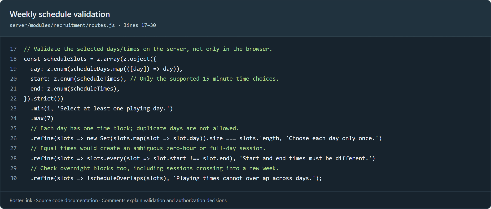
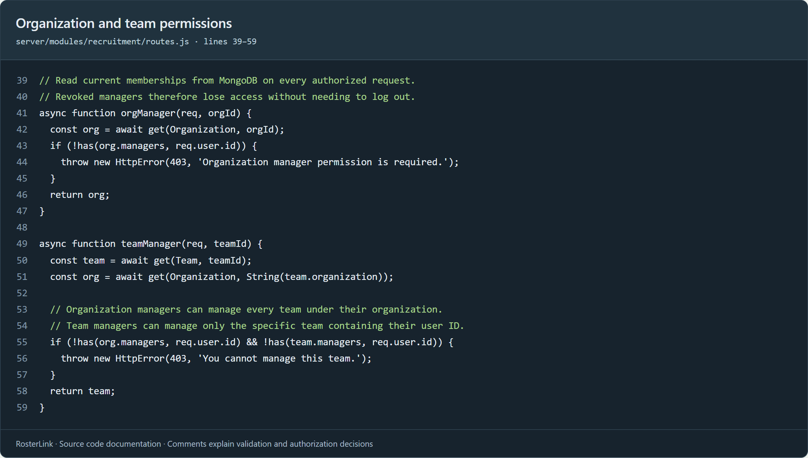

# Commented code screenshots

These PNG screenshots show actual RosterLink source code with explanatory comments, file paths and source line numbers. Insert the images and the captions below into the project documentation. Comments are highlighted in green. Only comments and formatting were added to the source for this documentation; application behavior is unchanged. `node --check server/modules/recruitment/routes.js` passed.

## Figure 1 — Weekly schedule validation

**Suggested caption:** Server-side validation ensures that recruitment schedules use supported days and 15-minute time choices. It requires at least one selected day and prevents duplicate days, equal start/end times and overlapping sessions, including overnight sessions that cross the week boundary.

Source: `server/modules/recruitment/routes.js`, lines 17–30.

## Figure 2 — Scoped management permissions

**Suggested caption:** Backend authorization reads current organization and team memberships from MongoDB. Organization managers can manage their child teams, while team managers can manage only their assigned teams. Unauthorized operations return HTTP 403, and revoked roles lose access on subsequent requests without requiring logout.

Source: `server/modules/recruitment/routes.js`, lines 39–59.
